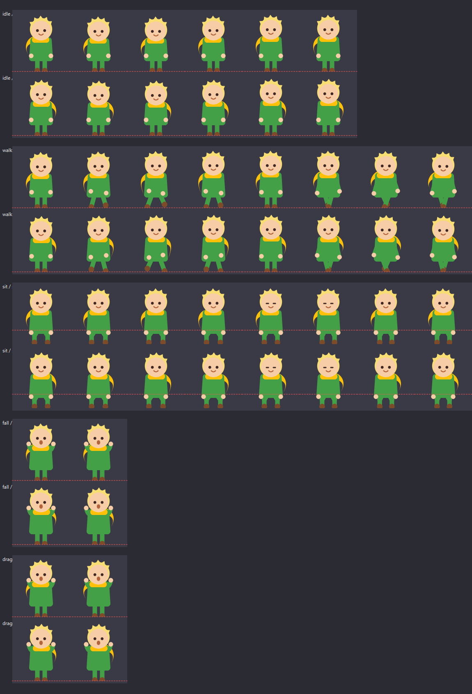
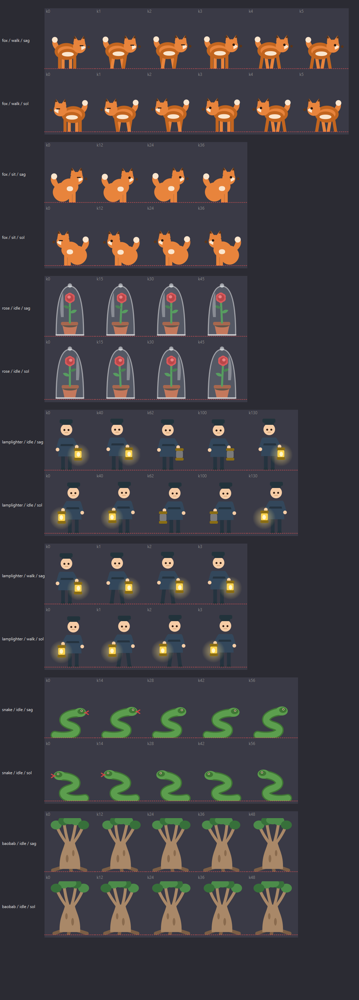

# Little Prince — Desktop Companion

A tiny Little Prince who lives on your Windows desktop: he walks along window
edges, sits down and dangles his legs, climbs and teleports between surfaces,
falls asleep when you leave him alone, and can **talk to you** with a built-in
small language model.

Two editions are shipped:

| Edition | File | Size | What's inside |
| --- | --- | --- | --- |
| **Classic** | `LittlePrince.exe` | ~43 MB | Everything except AI |
| **AI** | `LittlePrinceAI.exe` | ~60 MB | Classic + built-in model, Ollama & API support |

| Character | Companions |
| --- | --- |
|  |  |

## Features

- **Lives on your desktop** — a transparent, frameless, always-on-top window that
  never takes focus and never shows up in the taskbar.
- **Walks on real windows** — reads live window rectangles via Win32 and treats
  their top edges as platforms. He climbs, falls, lands and sits on them.
- **Sits & dangles** — sits on the edge with his legs hanging over it, minimum
  10 seconds so he doesn't get up instantly.
- **Teleports** — if there is another surface nearby, he occasionally vanishes in
  a puff of sparks and reappears there (default 30 %, at most every 20 s).
- **Sleeps** — after 90 seconds without interaction he dozes off with little
  "z z z" above his head. A click, a drag or simply moving the mouse near him
  wakes him up.
- **Reacts** — flails while dragged, panics while falling, bounces and says
  "Ouch!" after a hard landing.
- **Companions** — when he sits, one of his friends may join: the fox, the rose
  (under a glass dome), the lamplighter, the snake, or a baobab tree. Each
  arrival has two kinds of lines — the companion's **own** words in the
  companion's bubble ("Tame me!") and the Prince's **remark** about it in his
  own bubble ("The snake is here. Let us not move.").
- **Speaks 20 languages** — automatic from your system language, or pick one in
  the settings.
- **Says goodbye properly** — quotes come from the book, and every line is
  available in all 20 languages.

## Download & run

Grab the `.exe` from [Releases](../../releases) (or build it yourself, see below)
and double-click it. No Python, no installation.

- Settings are stored in `%APPDATA%\LittlePrince\settings.json`, so the app keeps
  them wherever you move the `.exe` (**never contains anything harmful, but can
  contain your API key** — it is not in the repository).
- Portable mode: put an empty `settings.json` next to the `.exe` and settings
  will live there instead.
- Start with Windows: press `Win+R`, type `shell:startup`, and drop a shortcut
  to the `.exe` in that folder.
- Quit: right-click the Prince → **Quit**.

## Controls

Right-click the character:

| Menu item | What it does |
| --- | --- |
| **Talk (AI)…** | Opens the chat window (AI edition only) |
| **Sit down / Get up** | Sits until you tell him to get up |
| **Wake up** | Wakes him immediately |
| **Say a line from the book** | Random quote |
| **Start wandering** | Puts him back into wander mode |
| **Teleport** | Jumps to another surface right now |
| **Settings…** | Character + AI options |
| **Bring to screen** | Recovers him if he gets lost |
| **Quit** | Closes the app |

Mouse: left-click turns him toward the cursor, drag to carry him, double-click
for a quote.

## Languages

`English, Türkçe, Español, Français, Deutsch, Italiano, Português, Nederlands,
Polski, Русский, Українська, 中文, 日本語, 한국어, हिन्दी, বাংলা, العربية, فارسی,
Bahasa Indonesia, Tiếng Việt`

- Default is **Automatic** (your Windows language).
- Font fallback is handled per script (CJK, Devanagari, Bengali, Arabic, Persian
  and so on), so no boxes appear instead of letters.
- The **interface** (settings and chat) is in English; only the character's
  speech and the right-click menu are localised.

## AI edition

Open the chat with right-click → **Talk (AI)…**. The model is prepared when the
window opens and **unloaded when you close it**, so nothing runs in the
background while you are not chatting.

Three providers (Settings → AI):

| Provider | What you need | Notes |
| --- | --- | --- |
| **Built-in model** | One click to download | Runs inside the app with llama.cpp, works offline |
| **Ollama** | [ollama.com](https://ollama.com) + `ollama pull llama3.2:1b` | Free, local, offline |
| **OpenAI-compatible** | An API key | Works on any machine |
| **Off** | Nothing | Quotes-only offline replies |

### Built-in model

The engine (llama.cpp) is bundled, the **model file is downloaded once** into
`%APPDATA%\LittlePrince\models\` so the `.exe` stays small:

- **Qwen2.5 0.5B** — ~470 MB, small and fast
- **Qwen2.5 1.5B** — ~1 GB, noticeably better Turkish and other languages

Downloads resume automatically if the connection drops. Everything runs on the
CPU, so it works on any machine — no GPU required.

### Cloud endpoints

- OpenAI: `https://api.openai.com/v1` — e.g. `gpt-4o-mini`
- Groq: `https://api.groq.com/openai/v1` — e.g. `llama-3.1-8b-instant`
- OpenRouter: `https://openrouter.ai/api/v1`
- LM Studio (local): `http://localhost:1234/v1`

> The API key is stored in plain text in your local settings file. Never commit
> that file — it is already in `.gitignore`.

## Settings

| Setting | Description |
| --- | --- |
| Language | One of 20, or automatic |
| Size | 0.7× – 3.5× |
| Walk speed | Step speed |
| Companion chance | Probability a friend joins when he sits |
| Teleport chance | Probability of jumping to another surface |
| Minimum time between teleports | Default 20 s |
| Minimum sit time | Default 10 s |
| Sleep / delay | Whether and when he falls asleep |
| Always on top | Keep the window above everything |
| AI provider / model / address / key | AI edition only |

## How it works

- **Transparent window:** `FramelessWindowHint + WindowStaysOnTopHint + Tool`
  with `WA_TranslucentBackground` — no taskbar entry, no focus stealing.
- **Art:** every character is drawn with vector code (`prince.py`,
  `companion.py`). No image assets are needed.
- **Physics:** gravity plus platform checks. The character's support point
  (feet, or hips when sitting/sleeping) is aligned to the platform's edge.
- **Windows:** `EnumWindows` + `DwmGetWindowAttribute` give the real frame
  rectangles of open windows; their top edges become platforms.
- **Always on top:** the taskbar also lives in the topmost band, so the window
  silently re-asserts `SetWindowPos(HWND_TOPMOST)` a few times per second — but
  only when something is actually above it.
- **DPI:** Win32 physical coordinates are converted to Qt logical coordinates,
  so alignment stays correct at 125 % / 150 % scaling.

## Building from source

```powershell
python -m pip install -r requirements-dev.txt
python tools\make_icon.py      # generates app.ico
build_all.bat                  # -> dist\LittlePrince.exe + dist\LittlePrinceAI.exe
```

Or just one edition: `build_noai.bat` / `build_ai.bat`.

Smoke test without opening the UI:

```powershell
$env:LP_SELFTEST="1"; dist\LittlePrinceAI.exe; Get-Content "$env:TEMP\lp_selftest.txt"
```

Run from source:

```powershell
python -m pip install -r requirements.txt
python main.py
```

## Project layout

```
main.py                 entry point (+ self test)
pet.py                  window, physics, sleep, teleport, reactions, menu
prince.py               Little Prince vector art
companion.py            fox / rose / lamplighter / snake / baobab art + windows
i18n.py                 20-language strings (quotes + menu)
features.py             AI on/off detection for the two editions
ui_font.py              font stack for CJK / Indic / Arabic scripts
llm.py                  AI backends (built-in llama.cpp, Ollama, OpenAI-compatible)
chat.py                 chat window + model downloader
config.py               settings load/save
settings_dialog.py      settings UI
win32_windows.py        Win32 helpers (window rects, z-order, topmost)
build_noai.bat          builds the classic edition
build_ai.bat            builds the AI edition
build_all.bat           builds both
LICENSE                 MIT for the code (story/character rights excluded)
tools/                  art previews, icon generator, diagnostics, tests
```

## Credits

- Story and characters: Antoine de Saint-Exupéry, *Le Petit Prince*.
- Quotes are based on the original French text; the English wording follows the
  classic Katherine Woods translation where well known. Other languages are
  faithful translations — published editions may differ slightly.
- Built-in model: Qwen2.5 (Apache-2.0), running on llama.cpp (MIT).
- UI framework: Qt for Python (PySide6).

This is a fan project. The Little Prince is not public domain in every country,
so please respect the rights of the estate and of the translators.

## License

The **source code** is released under the [MIT License](LICENSE).

The license covers **only the code**. It does **not** cover the book, its
characters, the quotations or the translations — those remain the property of
their respective rights holders and are included here as a non-commercial fan
tribute. See the scope section at the end of the `LICENSE` file.

## Legal notice

This is an **unofficial, non-commercial fan project**. It is not affiliated
with, endorsed by, or sponsored by the estate of Antoine de Saint-Exupéry, any
publisher, or any translator.

*The Little Prince* (*Le Petit Prince*) and its characters are still protected
by copyright in many countries. The quotes are reproduced as a fan tribute; all
rights to the story, characters and published translations belong to their
respective rights holders. The English wording follows the classic Katherine
Woods translation, which is separately copyrighted.

No commercial use is intended. If a rights holder requests removal, the project
will be taken down or renamed.

